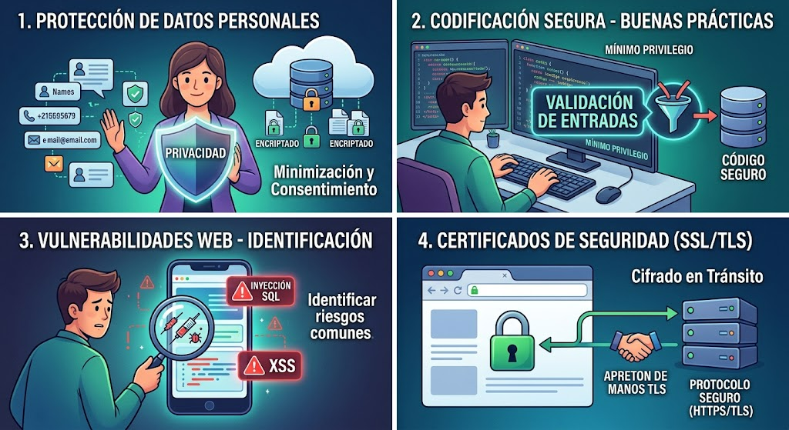

# Especificación de principios de codificación segura.

1. Protección de Datos Personales
La protección de datos personales es el marco normativo y técnico que garantiza que la información privada de los usuarios (como nombres, correos, datos financieros o historiales médicos) sea recopilada, almacenada y tratada de manera lícita, transparente y segura.

Principios clave:

Minimización: Solo se deben solicitar los datos estrictamente necesarios para el propósito del sistema.

Consentimiento: El usuario debe autorizar de forma explícita el uso de su información.

Confidencialidad e integridad: Asegurar que los datos no sean alterados ni expuestos a personas no autorizadas.

En la práctica: Implica cumplir con normativas internacionales (como el RGPD o leyes locales de protección de datos) y encriptar la información tanto en tránsito como en reposo.

2. Principios de Codificación Segura (Secure Coding)
Los principios de codificación segura son un conjunto de directrices y buenas prácticas orientadas a minimizar la cantidad de vulnerabilidades y fallos lógicos en el código fuente desde el momento de su diseño y construcción.

Buenas prácticas fundamentales:

Validación de entradas: Nunca confíes en los datos provistos por el usuario (o por sistemas externos). Todo input debe ser validado, sanitizado y filtrado.

Principio de mínimo privilegio: Cada componente, proceso o usuario debe tener únicamente los permisos indispensables para realizar su tarea.

Manejo seguro de errores: Los mensajes de error no deben revelar información técnica sensible (como rutas de archivos, versiones de software o trazas de la pila) que puedan ser utilizadas por un atacante.

3. Puntos de Vulnerabilidad en Aplicaciones Web
Las aplicaciones web suelen ser blanco frecuente de ataques debido a malas prácticas de desarrollo o configuraciones deficientes. Conocer las vulnerabilidades más comunes permite prevenirlas desde etapas tempranas.

Vulnerabilidades comunes:

Inyección (SQL Injection, Command Injection): Ocurre cuando datos no confiables se envían a un intérprete como parte de un comando o consulta, permitiendo al atacante ejecutar código malicioso.

Cross-Site Scripting (XSS): Permite a un atacante inyectar scripts maliciosos en páginas web vistas por otros usuarios, robando sesiones o información sensible.

Control de acceso roto: Fallos que permiten a los usuarios actuar fuera de sus permisos previstos (por ejemplo, acceder al panel de administración sin autenticación adecuada).

4. Certificados de Seguridad: SSL y TLS
Los protocolos de seguridad web aseguran que la comunicación entre el navegador del usuario y el servidor web viaje de manera cifrada e inviolable, protegiendo la información contra ataques de interceptación (Man-in-the-Middle).

Conceptos clave:

SSL (Secure Sockets Layer): El estándar de seguridad original para establecer enlaces cifrados. Hoy en día se considera obsoleto y vulnerable.

TLS (Transport Layer Security): El sucesor moderno y seguro de SSL. Las versiones actuales (como TLS 1.2 y 1.3) ofrecen altos estándares de cifrado y rendimiento.

Certificado Digital: Un archivo electrónico emitido por una Autoridad de Certificación (CA) que vincula una clave criptográfica con la identidad de un sitio web, validando su autenticidad (indicado visualmente con el candado en el navegador).

Un **Web Service** (servicio web) es un componente tecnológico que permite la comunicación entre diferentes aplicaciones o sistemas a través de la red (generalmente utilizando el protocolo HTTP/HTTPS). Su propósito principal es desacoplar el cliente (frontend, aplicaciones móviles, otros servidores) del backend, facilitando la interoperabilidad sin importar el lenguaje de programación o la plataforma en la que estén construidos.

# Implementación de WEB services en el desarrollo WEB.

## 1. Conceptos Fundamentales: SOAP vs. REST

La arquitectura de los servicios web ha evolucionado, destacando dos estándares principales para el intercambio de información:

### SOAP (Simple Object Access Protocol)

* **¿Qué es?** Es un protocolo estrictamente definido basado en **XML**. Requiere contratos formales mediante archivos WSDL (*Web Services Description Language*).
* **Características:** Altamente seguro, soporta transacciones ACID y opera de forma independiente al protocolo de transporte (aunque suele usar HTTP/HTTPS). Es común en entornos empresariales (banca, telecomunicaciones) por su rigurosidad.

### REST (Representational State Transfer)

* **¿Qué es?** Es un estilo de arquitectura basado en el protocolo **HTTP**. Utiliza los verbos estándar (`GET`, `POST`, `PUT`, `DELETE`) y suele intercambiar datos en formato **JSON**.
* **Características:** Ligero, rápido, altamente escalable y fácil de implementar. Es el estándar de facto para el desarrollo web moderno y APIs públicas.

| Característica | SOAP | REST |
| --- | --- | --- |
| **Formato de datos** | Exclusivamente XML | JSON, XML, HTML, Texto plano |
| **Estándar / Protocolo** | Protocolo estricto | Estilo arquitectónico (sobre HTTP) |
| **Velocidad y Peso** | Más pesado (mayor uso de ancho de banda) | Ligero y eficiente |
| **Seguridad** | WS-Security nativo y robusto | Basado en HTTPS, Tokens (JWT, OAuth) |

---

## 2. APIs de Terceros Aplicables al Desarrollo Web

Las **APIs de terceros** (Third-Party APIs) son servicios externos desarrollados por empresas o proveedores (como Google, Stripe, OpenAI) que los desarrolladores pueden integrar en sus propias aplicaciones web para añadir funcionalidades complejas sin necesidad de programarlas desde cero.

* **Ejemplos comunes:**
* **Pasarelas de Pago:** Stripe, PayPal, Mercado Pago.
* **Geolocalización y Mapas:** Google Maps API, Mapbox.
* **Autenticación Social:** Firebase Auth, Auth0, Google Sign-In.
* **Inteligencia Artificial:** OpenAI API, Google Cloud Vision.

---

## 3. Mecanismos para el Desarrollo de Web Services Propios

Para construir nuestros propios servicios web (principalmente APIs REST), los desarrolladores utilizamos frameworks modernos en distintos lenguajes:

* **Node.js (JavaScript/TypeScript):** Express.js, NestJS.
* **Python:** FastAPI, Django REST Framework.
* **Java:** Spring Boot.
* **PHP:** Laravel.

### Buenas prácticas en el diseño de APIs Propias:

1. **Uso correcto de verbos HTTP:** `GET` para consultar, `POST` para crear, `PUT`/`PATCH` para actualizar, y `DELETE` para eliminar.
2. **Estructura de rutas basada en recursos (Nouns):** Ejemplo: `/api/v1/customers` en lugar de `/api/getCustomers`.
3. **Códigos de estado HTTP estándar:** `200 OK`, `201 Created`, `400 Bad Request`, `401 Unauthorized`, `404 Not Found`, `500 Internal Server Error`.

> ⚙️ **Ilustración del desarrollo backend:**
> 

---

## 4. Mecanismos de Autenticación Remota de Web Services

Dado que los Web Services se exponen a través de internet, es fundamental protegerlos para garantizar que solo los usuarios o clientes autorizados puedan consumir los recursos. Los mecanismos más utilizados son:

* **Basic Auth (Autenticación Básica):** Envía las credenciales (usuario y contraseña) codificadas en Base64 en la cabecera `Authorization`. Es poco segura si no se transmite exclusivamente bajo HTTPS.
* **API Keys (Claves de API):** Un token alfanumérico único que se pasa en la cabecera o como parámetro de consulta. Es útil para identificar aplicaciones cliente, aunque ofrece menor granularidad de seguridad para usuarios finales.
* **Tokens JWT (JSON Web Tokens):** Un estándar abierto que permite transmitir información de manera segura entre partes como un objeto JSON. El servidor valida el token firmado digitalmente sin necesidad de consultar la base de datos en cada petición.
* **OAuth 2.0 y OpenID Connect:** El estándar de la industria para la autorización delegada. Permite que aplicaciones de terceros accedan a recursos protegidos sin exponer las credenciales del usuario (por ejemplo, el botón de *"Iniciar sesión con Google"*).

---
implementación práctica de una API REST con autenticación mediante JWT (JSON Web Tokens), que es el estándar actual más utilizado en la industria para asegurar servicios web.

¿Cómo funciona el flujo de Autenticación con JWT?
Autenticación (Login): El cliente (Frontend/App) envía su usuario y contraseña al endpoint /api/v1/auth/login.

Generación del Token: El servidor verifica las credenciales y, si son correctas, genera un token JWT firmado mediante una clave secreta (SECRET_KEY) y lo devuelve al cliente.

Peticiones Protegidas: El cliente guarda el token (por ejemplo, en localStorage o en una cookie HttpOnly) y lo envía en el encabezado (Header) de cada petición subsiguiente:
Authorization: Bearer <TU_TOKEN_JWT>

Validación: El servidor intercepta la petición, verifica la firma del token y procesa la solicitud si es válido.